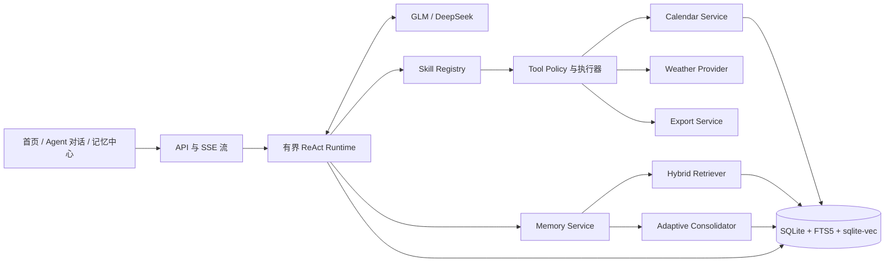

# Calendar Memory Agent 重构规格

> 状态：需求已确认，等待实施  
> 日期：2026-09-06  
> 适用项目：`calendar_agent`  
> 产品范围：本地、单用户、面向 Agent 岗位面试展示

## 1. 文档作用

本文是下一阶段重构的主规格，记录本轮访谈中已经确认的产品与技术决定。文中目标架构尚未全部实现，不能将其描述为当前代码已有能力。

旧版 README、Project10 计划、里程碑、前端设计、测试说明和项目讲解文档已经删除，避免后续实施继续引用失效需求。本文是当前唯一的项目级重构规格。

本次允许清空现有数据库，因此不建设复杂的旧数据迁移链。重构应继续沿用当前 `calendar_agent`，不另起一个大型应用。

## 2. 项目定位

项目是一个具有长期个人记忆的本地日历 Agent。它围绕用户的任务、偏好、经历和当前情境自主选择 Skill、调用 Tool、观察结果并继续决策，同时通过明确的权限和成本边界约束自主行为。

项目用于展示以下 Agent 工程能力：

1. 自研、有边界的 ReAct 运行时，而不是一次模型调用后直接执行 JSON。
2. 工作记忆、短期记忆、长期记忆的完整生命周期。
3. 结构化、关键词和语义信号结合的混合检索。
4. 事件驱动、风险自适应的记忆巩固与压缩。
5. Skill 与 Tool 分层，以及可在服务端强制执行的权限边界。
6. 流式可观察、可恢复、可评测的 Agent Run。
7. 对成功执行经验进行受控提炼的程序性记忆。

这里的 **ReAct** 指 Agent 的 Reason/Act/Observe 循环，不是 React 前端框架。前端继续使用轻量原生 JavaScript，避免引入大型构建系统。

## 3. 产品边界

### 3.1 第一版包含

- 本地单用户日历与任务管理。
- 首页、Agent 对话、记忆中心三个核心入口。
- GLM-5.3-Flash 与 DeepSeek-V4-Flash 的手动选择和失败回退。
- 天气规划 Skill。
- 日历导出 Skill。
- 三层记忆、五类长期记忆、来源追踪和用户控制。
- SQLite、FTS5、`sqlite-vec` 组成的本地混合检索。
- 合成数据评测与三组消融实验。
- Weather Skill 的程序性记忆候选演示。

### 3.2 第一版不包含

- 多用户、账号、云部署和跨设备同步。
- 独立向量数据库、图数据库或外部工作流平台。
- LangGraph 等 Agent 编排框架。
- React 前端框架。
- 澳大利亚政府灾害预警数据接入。
- 通用的自我进化 Skill 平台。
- Agent 自动永久删除数据。
- 将导出文件长期保存在项目中。

## 4. 总体架构



建议目录边界：

```text
calendar_agent/
  agent/
    runtime.py
    events.py
    queue.py
    budget.py
    recovery.py
  skills/
    registry.py
    weather_planning/
    calendar_export/
  tools/
    calendar.py
    weather.py
    export.py
    memory.py
  memory/
    service.py
    operations.py
    retrieval.py
    consolidation.py
    verifier.py
    blocks.py
    retention.py
  providers/
    llm.py
    embedding.py
    weather.py
  evaluation/
    datasets.py
    metrics.py
    ablations.py
  api/
  static/
```

这是职责划分，不要求为了匹配目录而一次性移动所有文件。每个阶段只移动已经纳入新链路的模块。

## 5. Agent 运行时

### 5.1 ReAct 生命周期

复杂任务按以下循环运行：

```text
接收用户目标
→ 组装 Memory Blocks
→ Reason / Decision
→ 选择 Skill
→ Skill 限制可用 Tools
→ 生成并校验 ToolCall
→ 执行 Tool
→ 写入 Observation
→ 判断继续、完成、失败或等待用户
```

运行状态至少包含：

```text
queued
running
waiting_for_user
completed
failed
cancelled
```

用户补充缺失信息时，恢复原 `agent_run_id`，不创建一个丢失前文的新 Run。

### 5.2 调用预算

| 任务类型 | 默认模型调用上限 |
|---|---:|
| 普通聊天 | 1 |
| 简单 Skill | 2 |
| 复杂 ReAct | 6 |

模型、Skill 和后台任务均不能自行提高上限。运行时还必须限制：

- 总 Token 预算。
- 单次工具输出大小。
- 重复工具调用。
- 连续无进展步骤。
- 总运行时间。

达到边界时，应返回可解释的失败或等待状态，不能假装完成。

### 5.3 队列与并发

- 使用 SQLite 持久化 Run 与队列。
- 前台用户 Run 优先于天气后台任务。
- 全局最多同时进行 2 个模型调用。
- 同一个 Session 同时只允许一个写 Run。
- 模型调用不得占用长时间数据库写事务。
- 浏览器断开不取消 Run；重新连接后从最后事件序号继续读取。

### 5.4 流式事件

所有面向用户的生成过程采用流式输出。建议使用 SSE，事件至少包括：

```text
run.started
thinking.delta
tool.call.started
tool.call.arguments.delta
tool.call.completed
observation.delta
memory.retrieved
answer.delta
run.waiting_for_user
run.completed
run.failed
```

Thinking 在界面中可展开、默认折叠。若模型供应商提供可展示的 `reasoning_content`，可按策略映射；否则展示结构化的决策摘要和进度，不依赖供应商一定返回原始推理文本。

Run 完成后，将大量 delta 合并为完整记录。完整 Trace 只保留最近 7 天或最近 100 个 Run，以先达到的限制为准；最终回答、关键决定和任务状态继续保留。

### 5.5 写操作和补偿

- 每个 ToolCall 使用独立事务。
- 每次写操作记录执行结果和可选补偿动作。
- 普通多步任务中，后续失败不自动撤销已经成功的合理操作。
- 只有 Skill 明确声明 `atomic: true` 时，运行时才按相反顺序执行补偿。
- 所有写工具使用 `request_id` 保证重试幂等，并使用版本字段防止旧状态覆盖新状态。

## 6. Skill 与 Tool

### 6.1 分层原则

Skill 是面向目标的能力包，Tool 是可执行的原子操作。

```text
ReAct Runtime
  → 选择 WeatherPlanning Skill
      → 允许 read_calendar
      → 允许 get_weather
      → 允许 create_adjustment_suggestion
      → 禁止 permanent_delete
```

每个 Skill 包含：

- manifest 与版本。
- 使用说明。
- 允许调用的 Tool 列表。
- 输入和输出 Schema。
- 权限策略。
- 成本策略。
- 评测案例。
- 是否支持补偿及是否为原子流程。

内置 Skill 受信任。目录扩展的第三方 Skill 必须声明数据、网络和写入权限，默认关闭写权限。

### 6.2 统一 ToolCall

所有工具请求转换为统一结构后再执行：

```json
{
  "tool_call_id": "tc_...",
  "run_id": "run_...",
  "skill": "weather_planning",
  "tool": "get_weather",
  "arguments": {},
  "request_id": "req_...",
  "expected_version": 3
}
```

Schema 校验、权限校验和成本校验全部在服务端执行，Prompt 中的文字约束不能代替代码约束。

## 7. 日历能力与权限

Agent 可以根据用户指令或已授权规则执行：

- 创建任务。
- 修改和重新安排任务。
- 归档与恢复。
- 完成任务。
- 生成天气调整建议。

永久删除只能由用户点击明确的 UI 控件触发。该能力不注册为 LLM Tool，模型也不能通过组合其他工具实现相同效果。

后台天气 Agent 只能创建调整建议，不能自动修改任务日期。用户接受建议后，前台 Run 才执行修改。

## 8. Weather Planning Skill

### 8.1 数据源

- 第一版通过 `WeatherProvider` 抽象接入 Open-Meteo 预报与地理编码。
- 不接入官方灾害预警。
- 保存预报摘要、查询时间、Provider 和响应哈希，不长期保存完整天气 JSON。
- 对查询结果设置超时和缓存，避免重复调用。

### 8.2 地点规则

1. 当前请求明确给出地点时使用该地点。
2. 未给地点时读取短期位置，再读取长期常住地。
3. 当前输入与记忆明显冲突时询问用户。
4. 临时旅行位置保存为带有效期的短期记忆，不直接覆盖长期常住地。

### 8.3 主动检查

- 用户可以显式要求查询天气。
- 规划户外活动时可主动调用 Weather Skill。
- 后台每天 Melbourne 时间 08:00 检查未来一天。
- 没有相关户外活动时，不调用天气 API 和 LLM。
- 天气结果没有跨越提醒阈值时静默结束，不产生重复提醒。
- 提醒只显示在首页。

代码按用户可配置阈值判断：

- 高降雨概率。
- 极端高温或低温。
- 强风。

模型只能结合活动解释影响和提出建议，不能修改阈值或将普通天气描述成已触发风险。

## 9. Calendar Export Skill

导出是独立可选 Skill，不进入核心 ReAct Loop。调用时询问：

1. 当前周还是当前月。
2. PDF、ICS 还是 CSV。

导出内容包含范围内的进行中和已完成项目，并标记状态。字段仅包括：

- 标题。
- 活动类型。
- 计划日期。
- Deadline。
- Checklist。
- 完成状态。

回收站和永久删除记录不导出；聊天、个人记忆、Thinking 和 Agent Trace 不导出。

文件由用户下载，项目不保留文件内容：

- ICS、CSV 优先直接流式响应。
- PDF 使用临时文件生成，响应结束后删除。
- 数据库只记录导出范围、格式、时间和结果等审计元数据。

## 10. 记忆架构

### 10.1 三个层级

| 层级 | 作用 | 典型生命周期 |
|---|---|---|
| Working Memory | 当前 Run 的目标、步骤、观察和待确认项 | Run 内 |
| Short-term Memory | 临时地点、近期安排、尚未稳定的偏好证据 | 有明确 TTL 或待巩固 |
| Long-term Memory | 跨会话稳定使用的事实、偏好、经历、任务语义和程序 | 长期、可修正和失效 |

### 10.2 五类长期记忆

| 类型 | 内容 | 写入时机示例 |
|---|---|---|
| `profile` | 常住地、稳定背景等 | 用户明确表达，且通过冲突检查后 |
| `preference` | 沟通、时间、活动偏好 | 显式表达时；隐式偏好需重复证据 |
| `episodic` | 有情境的经历和结果 | 会话或事件结束后，保留时间与敏感度 |
| `task` | 当前目标、承诺、未解决问题 | 任务创建或状态改变时立即更新 |
| `procedural` | 可复用的成功方法 | 多次成功后形成候选并通过回放评测 |

健康、情绪和关系经历可以进入 `episodic`，但必须带敏感度和不确定性。以下内容永不进入模型记忆：密码、API Key、身份证件号、银行信息、验证码，以及用户明确要求不要记住的内容。

### 10.3 Memory Blocks

每个 Run 只装配相关记忆，不把全部记忆塞入 Prompt：

- `User Block`：本次相关的 profile、preference 和 episodic 摘要。
- `Task Block`：当前任务、日历事实和未解决问题。
- `Agent Block`：当前 Skill、权限、预算和已启用程序性记忆。

日历数据库是日期、状态和 Checklist 的事实来源；记忆层只保存语义背景和引用，不能用旧摘要覆盖当前任务状态。

### 10.4 来源与用户控制

每条长期记忆保存：

- 来源消息或 Run。
- 形成时间与适用时间。
- 置信度。
- reported、inferred 或 uncertain 状态。
- 当前版本、压缩版本和父子关系。
- 锁定、失效和删除状态。
- 最近访问时间与访问次数。

用户可以在记忆中心查看、纠正、锁定、合并、删除和重新处理记忆。用户纠正始终优先于模型推断。被要求忘记的来源必须从检索、派生摘要、缓存和未来巩固中排除。

## 11. 混合检索

第一版使用 SQLite + FTS5 + `sqlite-vec`，不部署独立向量数据库。Embedding 默认由本地小模型生成，模型文件缓存在项目目录之外，不提交 Git；在线 Embedding API 作为可选 Provider。

索引记录 embedding 模型、版本和维度。模型变化时后台重建向量索引，旧索引在切换完成前继续服务。

检索流程：

```text
结构化过滤
→ FTS5 关键词召回
→ sqlite-vec 语义召回
→ 加入有效短期记忆
→ 去重和失效过滤
→ 代码重排
→ 必要时模型语义重排
→ 组装 Memory Blocks
```

代码重排使用：

- 向量相似度。
- 关键词匹配。
- 新近度。
- 重要性。
- 当前任务相关性。
- 置信度。
- 访问情况。

只有分数接近、记忆冲突或复杂经历召回时才调用模型语义重排。

## 12. 自适应记忆巩固管线

这套管线回答“对话如何变成记忆”，不同于记忆层级和长期记忆类型。

### 12.1 触发条件

巩固由事件触发：

- 用户明确要求记住。
- 任务完成或关键状态改变。
- Session 闲置。
- 出现稳定偏好。
- 观察到重复模式。
- Working Memory 接近上下文预算。
- 原文即将进入删除阶段。

字符数或 Token 数只作为资源保护线，不能作为记忆价值判断标准。

### 12.2 MemoryOperation IR

模型输出统一的结构化记忆操作：

```text
ADD
UPDATE
MERGE
SPLIT
PROMOTE
DEMOTE
EXPIRE
INVALIDATE
CONFLICT
NOOP
```

每项操作必须引用来源和目标版本。模型负责语义决定，代码负责 Schema、来源、权限、敏感内容和并发校验。

### 12.3 风险自适应校验

普通记忆由一个模型调用生成 `MemoryOperation`，随后通过确定性校验。

高风险记忆增加独立语义校验。高风险包括：

- 健康、情绪和关系等敏感经历。
- 人物、地点和精确日期。
- 长期身份或常住地变化。
- 未完成任务和承诺。
- 与已有记忆冲突。
- 即将导致原始正文删除的压缩结果。

高风险质量门检查：

- 是否引入来源没有支持的新事实。
- 是否遗漏未完成任务。
- 人物、日期和地点是否失真。
- 不确定性是否保留。
- 冲突是否被静默覆盖。
- 来源关系是否完整。
- 敏感信息和秘密是否被过滤。

### 12.4 存储形态

- 稳定、可更新的信息拆成原子记忆。
- 有上下文的经历保存为 episodic 摘要。
- 原子记忆与事件摘要都关联来源和彼此的关系。
- 不强制将所有内容压缩进同一种固定摘要模板。

### 12.5 七天恢复期

质量门通过后，原始消息进入七天恢复期。在此期间可以恢复、纠正或重新压缩。到期后删除正文，但保留：

- Message ID。
- 时间戳。
- 内容哈希。
- 压缩器版本。
- 产生的记忆 ID 和 lineage。
- 删除结果。

原文已经被用户要求忘记时，应立即从可用上下文中屏蔽；物理清理仍由确定性保留策略执行。

### 12.6 关键记忆离线验证

未来问题一致性测试只在合成数据、回归测试或离线评测中运行，不阻塞实时聊天。例如比较压缩前后是否仍能回答：用户通常在哪里、某项承诺是否未完成、某个偏好是否只在特定情境成立。

## 13. 程序性记忆

第一版只为 Weather Skill 建立一个受控演示：

1. 收集成功 Run 的结构化步骤和结果。
2. 在多个成功案例后生成 procedural memory 候选。
3. 使用历史合成案例回放候选流程。
4. 比较成功率、调用次数、Token、延迟和误操作。
5. 候选永不自动启用，由用户在记忆中心查看并决定。

程序性记忆保存策略，不保存某位用户的秘密原文，也不能扩大原 Skill 的工具权限。

## 14. 模型与 Provider

- 支持 GLM-5.3-Flash 和 DeepSeek-V4-Flash。
- 用户手动选择主模型。
- 请求失败时允许切换备用模型。
- 不实现按任务自动路由模型。
- 两个模型运行同一套合成评测，用数据比较质量、成本和延迟。
- LLM、Embedding 和 Weather 都通过 Provider 接口隔离。

供应商返回内容必须经过统一事件、ToolCall 和 MemoryOperation 协议，业务层不直接依赖某一家响应格式。

## 15. 成本控制

费用包括 LLM、可选在线 Embedding 和天气 API 调用。控制策略：

- 普通聊天保持一次模型调用。
- 简单 Skill 最多两次。
- 复杂 ReAct 最多六次。
- 先用代码检索和重排，只在歧义时使用模型重排。
- 普通记忆单次提取，高风险才使用生成器与校验器。
- 记忆巩固和程序候选批处理。
- 天气后台任务在没有户外事件或阈值变化时保持零 LLM 调用。
- 缓存天气、Embedding 和可复用的确定性结果。
- 对重复调用和无进展循环提前终止。

流式输出改善反馈速度，但不被描述为减少 Token 的机制。

## 16. 前端

### 16.1 首页

- 月/周日历和任务卡片。
- Deadline、完成状态和回收站入口。
- 天气调整建议。
- 建议接受、修改和忽略。
- 导出入口。

### 16.2 Agent 对话

- 流式答案。
- 默认折叠的 Thinking/决策摘要。
- ToolCall、Observation 和 Memory Retrieval 可展开记录。
- 断线重连和 Run 恢复。
- 历史 Run 放在本页，不增加独立页面。

### 16.3 记忆中心

- 按 profile、preference、episodic、task、procedural 浏览。
- 查看来源、置信度、状态、访问次数、关联任务和压缩历史。
- 纠正、锁定、合并、删除、恢复期查看和重新处理。
- 查看但不自动启用 procedural 候选。

## 17. 建议数据模型

表名可以调整，但职责应保持清晰：

| 表 | 作用 |
|---|---|
| `calendar_sessions` | 日历任务和当前事实状态 |
| `session_messages` | 七天恢复期内的消息正文和清理状态 |
| `agent_runs` | Run 状态、预算、模型和恢复游标 |
| `agent_events` | 有序流式事件与压缩后的完整记录 |
| `tool_calls` | 参数、权限决定、结果和补偿信息 |
| `skills` | Skill 版本、权限和启用状态 |
| `working_memory` | Run 级临时状态 |
| `short_term_memories` | TTL、证据和待巩固状态 |
| `memories` | 五类长期记忆及版本状态 |
| `memory_sources` | 记忆与消息、Run、任务的来源关系 |
| `memory_edges` | SQLite 内的轻量关系，不建设图数据库 |
| `memory_operations` | MemoryOperation 审计记录 |
| `memory_embeddings` | 向量、模型版本和维度 |
| `memory_jobs` | 巩固、校验、重建和保留任务 |
| `weather_cache` | 查询摘要、阈值结果和响应哈希 |
| `adjustment_suggestions` | 未执行的天气调整建议 |
| `export_audits` | 导出范围、格式和结果，不保存文件 |

数据库可以清空后重建新版 Schema。启动时应拒绝将未知旧 Schema 当成新版继续写入。

## 18. API 方向

建议新增或收敛为：

```text
POST /api/agent/runs
GET  /api/agent/runs/{id}
GET  /api/agent/runs/{id}/events
POST /api/agent/runs/{id}/messages
POST /api/agent/runs/{id}/cancel

GET  /api/memories
PATCH /api/memories/{id}
POST /api/memories/{id}/lock
POST /api/memories/merge
DELETE /api/memories/{id}
POST /api/memories/{id}/reprocess

GET  /api/skills
PATCH /api/skills/{id}

POST /api/weather/check
POST /api/calendar/exports
```

已有日历 API 可以在服务层稳定的前提下继续使用。永久删除 API 必须要求明确 UI 来源和服务端授权，不暴露给 Tool Registry。

## 19. 评测设计

所有评测使用合成用户、合成记忆和隔离数据库。真实个人记忆不得进入仓库、截图或基准结果。

### 19.1 消融组

| 组别 | 配置 |
|---|---|
| A | 单次模型调用，无长期记忆 |
| B | ReAct + 关键词记忆 |
| C | ReAct + 混合检索 + 自适应巩固 |

### 19.2 指标

- 任务成功率。
- Tool 选择准确率。
- Memory Recall@K。
- 记忆引用正确率。
- 失效或已忘记记忆的误召回率。
- 平均 ReAct 步数。
- 平均 Token 成本。
- 首 Token 延迟和总延迟。
- 压缩前后关键问题保持率。
- 程序性候选启用前后的成功率与误操作率。

### 19.3 核心测试

- Run 在浏览器断开后继续，重连不重复事件。
- 同一 Session 不发生并发写覆盖。
- 永久删除永远不出现在 LLM Tool 列表中。
- 后台天气检查只生成建议。
- 重复天气检查不会重复提醒。
- 临时地点不会覆盖长期常住地。
- 用户纠正后旧记忆立即退出检索。
- FTS 与向量召回均失败时不会伪造记忆。
- 高风险压缩不会改变人物、日期、任务和不确定性。
- 七天到期后正文删除，来源哈希和 lineage 保留。
- 导出文件在响应后不留在项目目录。

## 20. 分阶段实施与验收

### 阶段 1：Agent 核心

实施：

- Run、Event、ToolCall 数据模型。
- 有界 ReAct Runtime。
- SSE 流和断线恢复。
- SQLite 队列、并发和预算控制。
- 现有日历操作接入统一工具层。

验收：一个复杂任务能产生完整流式轨迹，服务重启后可读取状态；超过预算、重复调用和并发写均被确定性阻止。

### 阶段 2：记忆系统

实施：

- Working、Short-term、Long-term 三层服务。
- 五类长期记忆与 Memory Blocks。
- FTS5、`sqlite-vec`、本地 Embedding Provider。
- MemoryOperation、自适应巩固、高风险校验。
- 七天恢复期和记忆中心。

验收：跨 Session 正确召回；冲突会询问；纠正和忘记立即生效；压缩保留关键事实和来源。

### 阶段 3：Skills

实施：

- Skill Registry 与权限策略。
- Weather Planning Skill。
- Calendar Export Skill。
- Weather procedural memory 候选及回放评测。

验收：天气后台任务只在需要时工作并只生成建议；三种导出格式可下载且不留文件；程序候选不能自动启用。

### 阶段 4：面试材料

实施：

- 合成评测集和 A/B/C 消融。
- GLM 与 DeepSeek 对比。
- Archify 架构、数据流、Run 生命周期和记忆生命周期图。
- README、项目讲解稿和面试问答。

验收：评测可以一条命令复现，结果不含真实个人数据；讲解内容与代码和测试一致。

## 21. 面试演示主线

使用一个连续场景完成演示：

1. 用户说“明天下午安排户外跑步”。
2. Agent 从长期记忆取得常住地，同时识别当前是否存在临时地点。
3. Weather Skill 查询活动对应时段天气，确定性规则发现高降雨概率。
4. ReAct Loop 生成改期建议，后台不擅自修改日历。
5. 用户接受后，Agent 调用日历 Tool 修改安排。
6. 系统提取短期、长期和 episodic 记忆，并展示来源与压缩操作。
7. 用户在记忆中心纠正一条偏好，下一次规划立即采用新信息。
8. 展示 A/B/C 消融结果和两个模型的成功率、召回、Token、步骤数及延迟。

面试时可概括为：

> 我做的是一个本地日历记忆 Agent。它通过自研的有界 ReAct Runtime 选择 Skill 和 Tool，用工作、短期、长期三层记忆保持跨会话连续性。记忆不是按固定字数摘要，而是由事件和风险触发结构化 MemoryOperation；高风险内容增加独立校验。检索使用 SQLite 中的结构化过滤、FTS5 和 sqlite-vec，并通过来源、纠正和保留策略控制失真。天气 Agent 能主动发现明天的户外计划并提出调整建议，但服务端权限禁止它擅自修改或永久删除数据。最后我用消融实验同时评估任务成功、记忆召回和 Token 成本。

## 22. 完成定义

重构只有同时满足以下条件才算完成：

- 用户能在三个核心入口完成主流程。
- ReAct、Skill、Tool、Memory 的边界能在代码中找到，而不只存在于 Prompt。
- 所有输出流式展示，Run 可恢复。
- 权限和成本限制有确定性测试。
- 三层记忆、五类长期记忆、混合检索和自适应巩固均有端到端证据。
- 原文七天清理和导出临时文件删除可验证。
- 天气主动检查不重复提醒，也不自动调整任务。
- 永久删除不能由模型触发。
- 项目不提交模型权重、导出文件、真实数据库和真实评测数据。
- A/B/C 消融和双模型对比可复现。
- README、Archify 图、项目讲解与最终实现一致。
