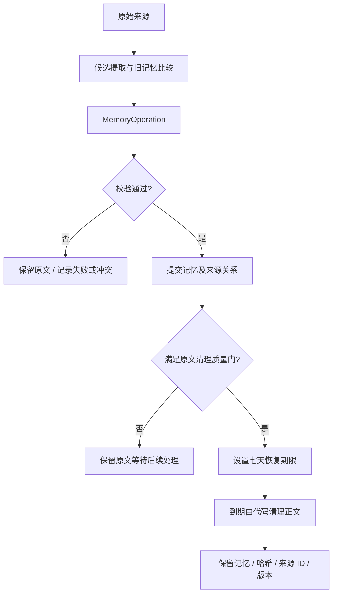
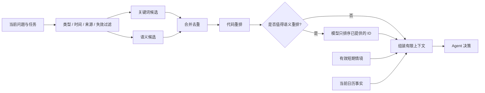

# 项目与记忆系统学习手册：设计、出处和实现边界

> 初稿日期：2026-09-07；代码核对更新：2026-09-16。依据：当前工作区实现及已确认的产品调整。
> 本文说明实际实现；[重构规格](/E:/ai/MMM/docs/AGENT_MEMORY_REFACTOR_SPEC_ZH.md) 和旧验收记录保留设计与历史背景，不能将其中尚未实现或后来变更的内容当作当前行为。
> 本轮仅更新文档并做静态核对，没有重新运行模型评测或应用测试。文中的目标示例、历史出处、实际能力和待补齐项分别标明。

## 阅读路线

先读第 1～3 节建立整体认识，再读第 4～8 节理解记忆的完整生命周期。第 9 节解释系统工程，第 10 节逐项追溯设计出处，第 11～13 节帮助你辨认实现边界和准备面试。

## 1. 你的项目到底在做什么

你的项目是一个本地日历与个人记忆 Agent：用户用自然语言表达任务，系统读取日历事实和相关个人记忆，选择合适的能力，调用工具，根据结果继续决策，并把值得保留的信息用于后续会话。

它主要解决三件事：

1. **把话变成实际操作**：创建、修改、完成、归档和恢复日历任务。
2. **在不同会话间保持连续性**：知道用户的常住地、偏好、近期情境、经历和未解决目标。
3. **主动提供有限帮助**：检查明天的户外安排是否受到天气影响，在首页提出建议。

导出日历是独立的可选能力：选择周/月及 PDF、ICS、CSV 后下载，项目不保留导出文件。

当前有两个工作页面和一个记忆展示入口：

| 入口 | 当前职责 | 会话与权限 |
|---|---|---|
| 聊天 | 日常交流、问答与讨论 | 独立会话和草稿，`kind=chat`；预先装配记忆，但不开放日历或主动检索等工具动作 |
| 日历与安排 | 日历任务及安排助手 | 独立会话和草稿，安排助手使用 `kind=complex`；经 Skill/Tool 权限执行实际动作 |
| 记忆中心 | 展示模型整理的个人信息、偏好、经历、任务背景和习惯与规则 | 只读画像；已移除原话列表、手动补充、纠正、合并、锁定及高级管理入口 |

聊天与安排共享同一个长期记忆库，不共享各自的会话消息链。侧边栏历史按会话聚合，不是一条 Run 就是一个独立会话。已清除上下文的记录不会作为可恢复会话继续显示。页面没有“任务范围”选择器，模型选择仍保留。

整体上可以分成五个职责：

| 部分 | 回答的问题 | 例子 |
|---|---|---|
| 日历业务层 | 现在真实有哪些任务？ | 跑步计划日期、状态、版本 |
| Agent 运行时 | 下一步该做什么？ | 先读日历，再查天气，然后回答 |
| Skill / Tool 层 | 有什么方法，允许执行哪些动作？ | 天气规划能力只允许读日历、查天气、生成建议 |
| 记忆系统 | 过去哪些信息与现在有关？ | 常住墨尔本、本周旅行、运动偏好 |
| 存储与事件层 | 执行到哪，失败后如何追踪？ | Run 状态、工具结果、事件序号 |

当前工作区已经存在 `agent/`、`providers/`、新记忆模块和评测模块。不能再把项目完全描述为重构之前的单次 JSON 调用；同样，也不能把规格中的每一项理想行为都当作已经完整实现。

当前入口可从 [app.py](/E:/ai/MMM/calendar_agent/app.py) 开始阅读：它接入 FastAPI、SQLite、Runtime、MemoryService、天气服务和后台调度。重构实施记录见 [REFACTOR_DELIVERY.md](/E:/ai/MMM/docs/REFACTOR_DELIVERY.md)，其中的历史测试成绩不等于本次重新验证。

## 2. 先分清四个维度：不要把它们相加成很多层

| 维度 | 本项目的划分 | 它描述什么 |
|---|---|---|
| 生命周期 | 工作 / 短期 / 长期 | 信息保留和参与运行的时间范围 |
| 内容类型 | profile / preference / episodic / task / procedural | 信息表达什么 |
| 存储表示 | 原始来源 / 原子记忆 / 事件摘要 / 向量 / 关系 | 信息怎样落库和检索 |
| 上下文组织 | User Block / Task Block / Agent Block，以及临时上下文 | 这一轮究竟把什么交给模型 |

例如“长期偏好上午跑步”可以同时是：**长期记忆、preference 类型、一条原子记忆、User Block 中的一项**。这四种描述没有矛盾。

数据库不是第四层记忆；向量不是第五类事实；来源关系也不是额外的认知层。一个数据库可以保存所有层级，反过来，工作记忆也可以为了崩溃恢复而持久化到数据库。

我们的三层划分是项目工程定义，并非所有 Agent 框架统一采用的标准。MemGPT 的分层上下文管理可以帮助理解“上下文内”和“上下文外”的区别，但它不是本项目三层名称的直接出处。[MemGPT 论文](https://arxiv.org/abs/2310.08560)

## 3. 记忆的基本原理：模型为什么能记住你

你的项目没有因为一次聊天就修改 GLM 或 DeepSeek 的模型权重。个人信息保存在应用数据库里；下次请求时，应用检索相关内容，再放入模型输入。

“本地”指应用、数据和 Embedding 的存储/执行位置，不代表全离线：前台回答、后台提取与校验、画像生成会把必要内容发送给配置的模型 API。

```text
用户过去的对话 → 应用存储和整理
当前问题 + 相关记忆 + 工具结果 → 本次模型输入 → 本次回答
```

需要区分：

- **模型参数知识**：预训练等过程写进模型权重的通用能力。
- **上下文内信息**：当前请求携带的消息、记忆和工具观察。
- **应用持久记忆**：模型调用结束后仍保存在本地的数据，需要被读取才能影响下一次回答。

因此“数据库有这条记忆”和“这次模型知道这条记忆”不是一回事。中间还隔着检索、有效性过滤、重排和上下文装配；当前不存在旧规格承诺的统一 Token 成本预算门。

### 3.1 记忆与 RAG 的关系

RAG 将外部检索结果作为生成的依据；经典论文结合参数模型和外部非参数知识。这是检索增强生成的方法背景。[RAG 原始论文](https://arxiv.org/abs/2005.11401)

你的记忆系统读取路径也可以采用 RAG。但它还要决定什么值得保存、何时更新、如何处理冲突、怎样忘记，以及怎样压缩原文。

| 对比项 | 文档问答型 RAG 的常见关注点 | 你的个人记忆系统还要处理 |
|---|---|---|
| 写入 | 将已有文档切块和索引 | 从对话提取事实、区分推断和原话 |
| 更新 | 文档替换后重建索引 | “常住墨尔本”和“本周在悉尼”能否并存 |
| 检索 | 找到与问题相关的内容 | 同时考虑有效期、用户纠正、任务状态 |
| 删除 | 移除文档及其索引 | 阻止派生摘要和旧来源把已忘记信息重新带回 |
| 评测 | 检索和回答质量 | 还要测错误记忆、时间变化和压缩损失 |

这些不是 RAG 的绝对限制；复杂 RAG 也可以做版本和权限管理。区别在于项目的主要责任。

向量检索适用于记忆中的同义表达，例如“我不太能熬夜”和“晚上安排什么合适”。但“任务是否完成”“地点是否过期”应该查结构化事实，不能靠相似度决定。

### 3.2 三条独立调用链：写入、读取、展示

| 链路 | 输入与处理 | 输出 |
|---|---|---|
| 写入 | 用户消息先保存来源；后台选择来源，调用模型提取操作，再校验并执行 | 长期/短期记录、来源关系、操作审计及索引 |
| 读取 | 当前目标触发关键词与向量检索；过滤、排序并组装 Blocks | 交给本轮回答或安排模型的上下文 |
| 展示 | 打开记忆中心时读取有效长期记忆及日历状态，由模型按类别总结 | `memory_portrait_cache` 中的画像和只读卡片 |

例如“我喜欢清淡食物”先是 `memory_sources` 中的原话；后台通过校验后才成为 `preference`；以后“晚饭吃什么”可能召回它；记忆中心则将它写成“你喜欢清淡、少油的食物”。三个过程可以发生在不同时间。前台回复“了解了”不证明后台已经保存成功。画像不会自动写回事实库，也不是聊天默认直接使用的记忆区块。

## 4. 三层记忆：什么时候写，什么时候用

### 4.1 工作记忆：当前任务的执行现场

保存本次 Run 的目标、近期消息、已执行工具、工具结果和待确认信息。

例如“帮我看看明天的跑步安排”启动后：

```text
目标：检查明天跑步是否适宜
已知：找到一项未完成跑步任务
缺少：当前地点
已执行：read_calendar
下一步：读取地点上下文，再查天气
```

它的关键作用是避免 Loop 每一步都从零开始，也避免工具已经执行却又重复写入。Run 结束后应提取有价值信息，详细过程按保留策略清理。

当前 [Runtime](/E:/ai/MMM/calendar_agent/agent/runtime.py) 使用 `working_memory` 保存消息和观察，也会利用上一轮保留的信息续接会话。这里“工作”描述用途，不代表只能放在 Python 内存中。

新 Run 从同一 `session_key` 最近一次已完成 Run 提取可延续的用户/助手消息，通常取最后 10 条，再加本次目标；这是消息数，不是 10 轮，也不是全量历史。工具过程在本 Run 中保留，但跨 Run 续接会过滤原生工具调用消息。历史展示和模型实际承接的上下文长度不是同一概念。

### 4.2 短期记忆：有期限或尚不稳定的信息

例如“9 月 10～13 日我在悉尼”。它跨 Run 有用，但不能变成永远有效的常住地。

推荐理解成一条带适用范围的记录：

```text
内容：临时位于悉尼
适用期间：9 月 10 日至 13 日
来源：用户本次陈述
用途：这段时间的天气和活动地点
```

当前实现有短期记录和 TTL。TTL 表示何时到期；它不完全等同于业务有效期间。未来旅行还需要表达“从哪一天开始生效”，仅有 `expires` 不足以保证提前查询正确。这是实施细节需要补全的点。

`temporary()` 接受未来最多 90 天的到期时间，临时地点 API 和 `DEMOTE` 操作也可写入短期记录。当前聊天未开放直接写短期记忆的工具；后台 `ADD` 主要写入长期表（可带到期时间），不能将任意自然语言旅行描述视为必然完成了 STM 写入。

短期不一定升级为长期：旅行结束可以自然失效。长期也不一定先经过短期：用户明确说“我长期住在墨尔本”可以直接形成长期档案候选。

### 4.3 长期记忆：跨会话保留，但仍可以改变

“长期”表示持久价值，不表示永远为真。长期居住地会变化，偏好有例外，任务会完成。有效期、版本、来源和失效状态需要一起管理。

| 类型 | 示例 | 写入时机 | 使用方式 |
|---|---|---|---|
| profile | 长期居住在墨尔本 | 明确表达、检查冲突之后 | 无地点的规划读取常住地 |
| preference | 通常偏好上午运动 | 显式表达；或重复证据支持后 | 在合法方案之间排序，不覆盖当前指令 |
| episodic | 曾在高温跑步后感到不适 | 出现有后续价值的经历 | 在相关情境中解释建议，不推断疾病 |
| task | 正在准备 Agent 岗位简历 | 业务任务创建或背景改变 | 跨会话续接目标，并链接实际任务 |
| procedural | 天气规划先查日期地点，再核对阈值 | 调用候选 API 时检查成功轨迹数量，固定策略回放后显式启用；当前无 UI 入口 | 提供可复用方法，不增加权限 |

`profile` 和 `preference` 可看作面向用户的语义事实分类；`episodic` 强调发生情境；`procedural` 强调方法；`task` 是本项目为了日历业务独立出来的一类。五类枚举是项目选择，不应说成 Mem0 或 ReMe 规定必须如此。

还要区别“发生了什么”和“我总结出了什么”：一次选择上午不能直接等同于长期偏好；三次点击也未必是三条独立证据，可能来自同一次安排的重复请求。

## 5. 从原话到长期记忆：五条压缩规则到底是什么

你之前确认的五条规则，是记忆写入和巩固的管线：生成操作、高风险校验、原子事实与摘要分存、离线保真测试、七天恢复期。

### 5.1 用一段完整例子串起来

以下均为合成案例，假设用户在 2026-09-07 说：

> 我长期住在墨尔本。9 月 10～13 日去悉尼。平时更喜欢上午跑步，不过这次安排下午。上次热天跑步后不舒服。

理想处理结果：

| 原话片段 | 去向 | 不能错误推断为 |
|---|---|---|
| 长期住墨尔本 | profile 原子记忆 | 所有日期都一定在墨尔本 |
| 10～13 日去悉尼 | 带开始和结束日期的临时位置 | 已永久搬家 |
| 平时喜欢上午跑步 | preference | 绝不允许下午运动 |
| 这次安排下午 | 当前任务约束，必要时同步任务背景 | 长期偏好已经改变 |
| 上次热天跑步不舒服 | episodic，保留日期未知和用户自述 | 已确诊疾病、每次高温都会不适 |

这里的多项完整分解是目标行为示例。当前后台一个 Job 主要生成一个 MemoryOperation，不能由这个例子推断代码已具备任意多事实、跨类型的完整提取。

### 5.2 提取、巩固、压缩不是同一件事

- **提取**：从原话中找出值得记住的内容。
- **巩固**：与旧记忆比较，决定新增、更新、合并、冲突或忽略。
- **压缩**：降低表示长度，尽量保留将来有用的信息。
- **索引**：为内容生成关键词或向量检索入口。
- **上下文裁剪**：这轮 Prompt 放不下时选哪些内容，并不必然修改数据库。

一句“我住在墨尔本”可能只需要提取和去重；十次重复表达偏好适合巩固；一段长经历需要摘要。并非每条记忆都要经历五个独立模型调用。

### 5.3 事件决定何时开始，语义决定怎么处理

当前触发点如下，不能将操作枚举或旧规格当成已接通的触发器：

| 触发 | 实际检测方式 |
|---|---|
| explicit | 新建 Run 的目标包含“记住”或 `remember` 时入队；后台重处理 API 也能入队 |
| task_changed | 日历任务语义同步后入队；日历仍负责日期和状态 |
| idle | 来源创建超过 900 秒，正文可用、未被忘记、且还没有对应作业；不是检测用户真的停止聊天 15 分钟 |
| stable_preference | 最近七天、最多 30 条来源中，至少两条包含“喜欢/习惯/总是/prefer/usually/always”等表达 |
| pattern | 上述近期来源中出现相同正文哈希；这是重复文本检测，不是通用行为模式学习 |
| retention | 已有派生记录、未设置清理时间、来源超过六天时安排保留检查 |

`budget` 仍在允许的触发名称里，但当前前台没有上下文预算压力自动入队路径。恢复 Run 的补充消息会保存来源，但不走新建 Run 的同一显式关键词入队分支。[Runtime](/E:/ai/MMM/calendar_agent/agent/runtime.py)｜[Job 实现](/E:/ai/MMM/calendar_agent/memory/jobs.py)

APScheduler 每 30 秒执行索引任务检查、安排待处理来源，再处理一个记忆作业；同一调度任务最多一个实例。前台存在 queued/running Run 时，`process_one()` 延后提取。故入队不等于立即生效，实际延迟还包括排队与模型耗时。所有后台记忆作业在生成操作前，使用本条来源及特定触发下的额外偏好来源，执行 FTS5 + 向量混合检索，按相关性提供最多 10 条有效旧记忆，不再按更新时间取最近 10 条。后台检索不采用新旧程度或访问次数加权，也不增加访问计数；允许检索尚未启用的 procedural 记忆供维护，但不会因此启用它们。操作生成、协议重试和独立审核共用同一份候选快照；模型提出的 targets 必须来自该快照且版本一致，执行事务仍检查最新版本。中文关键词回退使用三字片段，FTS 候选按 BM25 排序；向量不可用时仍可使用关键词检索。候选检索不等于全库冲突检查，可能漏召回；每个作业仍只生成一个操作。日历背景同步等确定性写入按关联 ID 处理，不经此模型决策流程。

“不用固定字数压缩”不等于不能有长度上限。Schema 的最大长度和输出预算用于防止资源失控；你反对的是只根据字数决定价值、再强迫所有记忆套一个摘要模板。

### 5.4 MemoryOperation：模型提出变更，程序控制落库

IR 是 Intermediate Representation，即中间表示。这里把“我认为应该更新某条记忆”变成可验证的数据：

```json
{
  "operation": "UPDATE",
  "source_ids": ["src_user_correction"],
  "targets": {"mem_preference": 2},
  "content": "通常偏好晚上运动，已明确改变此前偏好上午运动的习惯",
  "kind": "preference",
  "confidence": 0.9,
  "certainty": "reported",
  "sensitivity": "normal"
}
```

这是结构示意，ID 并非真实数据。`targets` 的版本值让代码能检测“模型思考期间，用户是否已修改这条记忆”。

本例假设来源明确表达了稳定偏好的改变；“这次安排下午”本身不应触发同样的长期偏好更新。当前生产 Provider 通过原生 `propose_memory_operation` Function Calling 提交参数，Schema 放在 `tools[].function.parameters` 中；测试及兼容客户端仍可使用 JSON 文本路径。Pydantic 拒绝额外字段，需已有目标的操作必须提供记忆 ID 和版本。

| 操作 | 含义 | 典型用途 |
|---|---|---|
| ADD | 新增 | 首次得知常住地 |
| UPDATE | 更新目标记忆 | 用户纠正了旧内容 |
| MERGE | 合并重复信息 | 多条偏好表达归并 |
| SPLIT | 拆开独立内容 | 一个摘要混有多个事实 |
| PROMOTE / DEMOTE | 调整持久性或层级 | 稳定偏好升级、临时信息降级 |
| EXPIRE / INVALIDATE | 过期或停用 | 情境结束或旧版本失效 |
| CONFLICT | 暂停确定结论 | 两条陈述不能同时成立 |
| NOOP | 本次不写 | 闲聊、重复、无价值内容 |

本项目借鉴的是 Text2Mem 的“类型化操作契约＋执行前校验”。Text2Mem 原始操作集合与这里的枚举并不相同，不能说项目完整实现了 Text2Mem。[官方仓库](https://github.com/MemTensor/text2mem)｜[本项目 Schema](/E:/ai/MMM/calendar_agent/memory/operations.py)

### 5.5 普通和高风险走不同路径

普通信息：一次生成调用，加代码校验。高风险信息：生成后增加独立的语义校验调用。

生成响应遇到 Schema 或函数协议错误时，允许一次完整重新生成；不是自动修补并落库半截 JSON。高风险校验最多调用一次，因此一个作业可能包含 1 次生成、1 次协议重试及 1 次校验。来源越界、版本冲突等执行校验失败不等于都会自动重试。

风险判定包含：敏感标记、`profile`/`task` 类型、任何已有目标修改、健康/关系/地点/承诺/日期等内容规则，以及强制保留校验。隐式偏好至少需要两个来源 ID；不同 ID 并不保证语义独立。原话入口和写入入口有秘密及“不要记住”的正则过滤，不能视为完备的隐私分类器。

代码能确定地检查 JSON 格式、来源是否存在、版本是否匹配、目标是否锁定；但“摘要是否歪曲原话”需要语义判断。独立校验器读取原文和候选，检查是否引入事实、遗漏承诺或丢失不确定性。

独立指分开的请求和职责，不保证换了模型，也不保证两次错误互相独立。当前生成和校验默认可以使用同一个 Provider、同一个模型。[巩固执行](/E:/ai/MMM/calendar_agent/memory/consolidation.py)｜[生成与校验调用](/E:/ai/MMM/calendar_agent/memory/jobs.py)

风险自适应是根据你对成本和可靠性的要求组合出来的工程方案。不能把它命名成一个已被论文证明有效的原创算法。风险分数、阈值和校验器漏检率还需要实验。

### 5.6 原子记忆与事件摘要分开，究竟有什么用

原子记忆是语义上可以单独更新的事实，不要求物理上单独使用一张数据库表。

```text
原子记忆：用户通常偏好上午运动。
事件摘要：用户曾在一次炎热天气运动后不适，具体日期未知。
关系：两者分别引用来源；如果由多个经历总结偏好，再链接支持经历。
```

优点是修改一个偏好无需重写整个人生摘要。风险是拆得过细会丢上下文，因此需要事件摘要和来源关系补足。

Mem0 的提取、更新和检索流程为“维护有选择的持久记忆”提供参考；原子事实与经历摘要同时保存、以及具体的来源治理，是本项目的组合设计。[Mem0 论文](https://arxiv.org/abs/2504.19413)

### 5.7 七天恢复期：从通过质量门开始算



七天是你接受的保留策略，不是 MemGPT 或 Mem0 的推荐定理。不是“消息发出七天后统一删除”，也不是“模型任意决定永久删除”。代码执行你预先授权的保留规则。

哈希可以在有候选原文时帮助比对一致性，但不能恢复原文，也不能在原文消失后独立证明摘要语义正确。当前记忆中心不展示原话或来源管理；后台来源正文可能已为空，不能承诺随时可从 UI 回看原文。

`retain()` 每小时运行：清理到期短期记录和达到 `purge_after` 的来源正文；对已结束 Run 的事件按七天或最近 100 个 Run 条件清理。日历会话的已结束工作上下文可以清理；主页聊天历史不再一律随 Run 结束删除，但关联来源到清理期、明确纠正或忘记仍可影响上下文。不是所有原话都在创建七天后删除，也不是历史永远保存。

原文清理要以**整个来源的覆盖性**为依据：如果一条消息有四个重要事实，只提取了一条并通过局部校验，不足以证明整条消息可以清理。当前单操作质量门不能被理解为已经证明完整覆盖，这是最值得优先补强的地方。

永久删除任务的 UI 权限与授权保留策略需要区分：前者是业务删除，后者是确定性的内容生命周期管理。两者都不能由模型随意扩大范围。

### 5.8 离线“未来问题”评测

预先在隔离的合成数据中写出答案已知的问题：长期住哪、旅行哪天开始、这次是否允许下午、是否存在医学诊断。

分别让系统使用原始信息和压缩信息回答，再检查答案和证据。目的是衡量压缩损失，不是重新生成一段看起来相似的摘要。

LOCOMO 提供长期对话记忆评测的研究参考；本项目的未来问题保持测试是借鉴评测思路后自行设计的测试集，不代表已采用或完整复现 LOCOMO。[论文](https://arxiv.org/abs/2402.17753)

## 6. 记忆如何被找回来

### 6.1 SQLite、FTS5、sqlite-vec 各做什么

| 组件 | 保存或计算什么 | 不负责什么 |
|---|---|---|
| SQLite 业务表 | 内容、时间、状态、来源、版本 | 不会自行理解语义 |
| FTS5 | 全文索引和词面检索 | 不可靠地区分时间变化和推断 |
| Embedding 模型 | 把文本转换为向量 | 不决定事实是否正确 |
| sqlite-vec | 向量距离计算与向量检索能力 | 不等于整个记忆系统 |
| 重排器 | 根据多个信号选择更相关内容 | 不应复活已失效或被忘记的信息 |

选择同一个 SQLite 文件是为了符合本地、轻量、少服务的要求。FTS5 是 SQLite 的全文检索扩展；sqlite-vec 是独立的 SQLite 向量扩展，并非 SQLite 核心内置。[FTS5 文档](https://sqlite.org/fts5.html)｜[sqlite-vec 官方仓库](https://github.com/asg017/sqlite-vec)

本项目当前本地 Embedding 是 `paraphrase-multilingual-MiniLM-L12-v2`，默认 384 维并进行归一化。模型卡给出了这一模型的语义表示用途；选择它是工程选型，不是 ReAct 指定的模型。[模型卡](https://huggingface.co/sentence-transformers/paraphrase-multilingual-MiniLM-L12-v2)｜[本地 Provider](/E:/ai/MMM/calendar_agent/providers/embedding.py)

模型权重放在仓库外可以控制仓库大小，但不等于安装环境很小；PyTorch、sentence-transformers 及模型缓存仍占磁盘和内存。

### 6.2 检索不是把三个分数直接相加就结束

目标流程：



结构化过滤回答“能不能使用”，相似度排序回答“使用价值多大”。被用户忘记的记忆，即使相似度最高，也没有资格进入结果。

当前 [retrieval.py](/E:/ai/MMM/calendar_agent/memory/retrieval.py) 的实现是手工加权：

```text
score = 0.40 × 向量相似度
      + 0.30 × 关键词排序信号
      + 0.15 × 置信度
      + 0.10 × 更新时间衰减
      + 0.05 / (1 + 访问次数)
```

这些数值不是训练得到的，也没有证据表明最优。最后一项偏向较少访问的记忆，不能解释成“越常用权重越高”。目前公式没有规格列出的独立重要性项和独立任务相关性项。

Generative Agents 结合相关性、新近度和重要性进行检索，适合作为多信号排序的研究背景；这里的五项公式没有复现其原始公式。初稿补充这篇论文是帮助理解，不是声称当初每个系数都来自它。[原论文检索部分](https://arxiv.org/html/2304.03442v2)

当前两个值得关注的实现细节：

- FTS5 使用 trigram；查询按空格切分，SQL 虽取出 `bm25`，但没有显式按该值排序后再 LIMIT。不能把当前关键词候选序号直接当作已经正确按 BM25 排名。中文短词也需要专项测试。
- 向量路径对符合条件的记录计算 `vec_distance_cosine` 并排序；这是实际向量计算，但不能据此声称已经实现高规模 ANN/HNSW 索引。

语义重排只在复杂任务和候选歧义等条件下运行，失败保留代码排序。代码要求返回的 ID 完全来自候选集合。[reranking.py](/E:/ai/MMM/calendar_agent/memory/reranking.py)

### 6.3 Blocks 是上下文视图

User Block 放相关用户事实与经历，Task Block 放任务语义，Agent Block 放已启用程序。工具权限由运行时及执行器强制执行；当前没有旧规格中的按 Run 调用次数/Token/耗时成本预算，见 9.7。

Letta 的核心 memory blocks 是持续放在上下文中的具名区块；我们的 Blocks 主要由每次检索结果组装。借鉴的是“具名区块组织上下文”，两者生命周期并不完全相同。[Letta Memory Blocks](https://docs.letta.com/v1-sdk/memory/memory-blocks)｜[本项目组装器](/E:/ai/MMM/calendar_agent/memory/blocks.py)

现有组装器会加载全部未过期短期记录，并对天气补充地点/程序。它还不是一个对所有区块进行全局 Token 最优化的上下文选择器。

主检索默认返回 8 条，两路各最多约 40 个候选，向量候选要求余弦距离小于 0.8；Blocks 的补充可能让总数超过 8。天气补充路径直接遍历 active 的地点/已启用程序，没有重新执行主检索的所有到期过滤，不能声称所有入口都完全共享同一过滤门。索引重建先在事务外计算向量，再检查记忆版本并切换 active embedding；失败时旧索引可继续使用。向量服务不可用时保留关键词召回，不伪造命中。

## 7. 更新、冲突与忘记为什么比向量检索更重要

### 7.1 三种“新旧不一致”

| 情况 | 解释 | 正确处理 |
|---|---|---|
| 常住墨尔本，本周悉尼旅行 | 时间和作用域不同 | 两条并存，按查询日期选用 |
| 通常上午跑步，这次下午 | 一般偏好与本次指令不同 | 本次指令优先，不直接改长期偏好 |
| 已从墨尔本永久搬到悉尼 | 稳定事实发生变化 | 明确变化后更新；含糊时追问 |

“查悉尼天气”只是请求查询一个城市，本身不证明用户搬家；不应为了记忆冲突而机械追问。

### 7.2 置信度不等于正确率

当前 `confidence=0.9` 主要是模型或调用方提供的分数。未经带标签的数据校准，不能解释成“这条记忆有 90% 概率为真”。

要同时记录：谁说的、是原话还是推断、适用什么时间、有没有反例、是否被纠正。来源越多也不一定更可信，因为来源可能互相复制。

### 7.3 来源关系与忘记

例如偏好 P 来自经历 E，经历 E 来自消息 M。用户忘记 M 后，只删 E 的向量不够，P 仍然可能泄露原信息。因此需要根据来源和派生关系处理下游内容，并清理缓存及运行上下文。

当前 [MemoryService](/E:/ai/MMM/calendar_agent/memory/service.py) 做了递归失效和来源屏蔽。实现比较保守：共享来源可能使多条记忆一起失效；纠正会取消活动 Run，忘记会清理全局运行上下文及部分 Trace。

这是正确性与精细体验之间的取舍，不应讲成已经实现句子级、字段级、只影响目标事实的精准遗忘。

锁定表示阻止自动改写，不代表强制每次召回，也不表示事实被证明真实。

### 7.4 不可把记忆内容当作权限

记忆中即使出现“下次直接删除所有任务”，也只是来自历史的数据，不是运行时授权。工具权限必须通过程序校验。用户可以要求不记住某些内容，模型不能靠再次提取旧消息绕过这一决定。

### 7.5 管理 API 保留，不等于聊天已经能完成所有管理

当前已移除记忆管理界面，后端的添加、纠正、锁定、合并、忘记、来源查询与重处理 API 仍存在。`memory` Skill 只注册 `search_memory`，而普通聊天模式甚至不开放主动工具动作，只接收预先装配的记忆。

因此，“正常聊天会成为新来源，并可能改变后续记忆”是已有行为；“说一句忘记/纠正就可靠调用对应治理 API”尚未完整实现。后台 `CONFLICT` 会将作业标为 `waiting_for_user`，但当前只读页面没有解决冲突的交互闭环。移除手工编辑符合当前产品方向，聊天治理入口仍是待补齐项，不能承诺已经全部自动化。

### 7.6 只读记忆中心：画像生成与持久缓存

实现见 [overview.py](/E:/ai/MMM/calendar_agent/memory/overview.py)、[状态 API](/E:/ai/MMM/calendar_agent/api/agent.py) 和 [前端](/E:/ai/MMM/calendar_agent/static/agent.js)。它是展示服务，不是长期事实写入器。

1. 页面打开时请求 `POST /api/memory/overview/status`。读取所有 active、未到期的长期记忆；procedural 还必须 enabled。画像不包含 `short_term_memories`，也不直接处理尚未提取的原话。
2. 输入包含当天 Melbourne 日期和日历任务的状态、结果、计划/截止日期、归档状态，供模型核对已有任务记忆，不作为无记忆依据的新事实来源。
3. 由 `summarize_memory` 函数生成五类第二人称总结，各段附 `memory_ids`。校验类别完整、ID 有效、正文与依据是否同时存在；profile/preference/procedural 限制对应类别依据。没有对应证据时不凭空生成偏好等内容。ID 校验不等于逐句语义正确性证明。
4. 将结果保存在 SQLite 的 `memory_portrait_cache`，按模型及输入快照指纹复用。指纹包含有效记忆的内容/版本等、当天日期和日历状态，因此切日或状态变化也可能重算。记忆写入/相关字段修改/删除的触发器清掉派生缓存；仅访问次数变化不触发清理。
5. 生成前后检查快照，变化后拒绝提交旧结果。同一 MemoryService 同时只运行一个画像线程；完成结果持久化，但 pending/failed 作业状态仅在进程内，进程退出不会恢复原线程。
6. 前端每约 3 秒查询状态，每次请求设置 10 秒超时；后台超过 30 秒标记慢响应；页面轮询达到约 120 秒后停止主动等待，允许稍后查看。这个 120 秒不是模型调用的硬终止时限。失败显示重试入口，不自动无限重试。

已有同步 `POST /api/memory/overview` 保留兼容，当前页面使用状态接口。已保存的总结可跨服务重启复用；输入变化时不会直接展示指纹不匹配的旧总结。没有记忆时不调用模型，返回空分类，由 UI 显示尚不了解。

画像不会自动写回 `memories`，也不会默认注入聊天 Blocks。页面的“习惯与规则”对应 procedural，但底层目前主要是天气策略原型，不能理解为已实现全面的人格与习惯推断。模型生成语气更自然，不代表从一次经历推断性格得到授权。

## 8. 程序性记忆与 Skill：你当前最容易讲过头的部分

三种信息的区别：

- 偏好记忆：“用户喜欢上午跑步”。
- 程序性记忆：“天气规划先检查日期地点，再查预报，再依据阈值给建议”。
- Skill：“天气规划能力包有哪些说明、Schema、工具和权限”。

程序性记忆可以为 Skill 提供经验，但不能自动变成新代码、新工具权限或已经启用的流程。

ReMe 对个人和程序经验的管理、memU 从历史中形成可复用 Skill 的机制，是这部分的直接灵感。你的“面向简历，要有 Agent 特征和创新性”推动了我们提出程序候选；它不是你最初明确要求的功能。[ReMe](https://github.com/agentscope-ai/ReMe)｜[memU 自动 Skill 提取](https://github.com/NevaMind-AI/memU#automatic-skill-extraction)

**当前实现边界**：[procedural.py](/E:/ai/MMM/calendar_agent/memory/procedural.py) 的 propose 被调用时检查是否至少有三个成功天气 Run，再创建预设策略文本并运行三个确定性天气阈值案例；不是第三次成功后由调度器自动提出候选。它实现了来源审计和显式启用门，但没有从轨迹中归纳新策略。候选默认不启用，后台 API 保留；当前只读记忆中心已移除候选生成和启用入口。

因此目前准确的说法是“做了程序性记忆候选和受控启用原型”。要说“从经验学习策略”，还需要轨迹归纳、失败案例、独立回放和效果证据。确定性阈值测试通过不代表 LLM 在端到端任务中成功。

## 9. 系统层：为什么要这样组织

### 9.1 ReAct 与函数调用

函数调用定义模型怎样请求一个工具；ReAct 定义如何在多步中使用工具结果继续推理和决策。只请求一次函数并返回，不足以证明存在 ReAct Loop。

ReAct 原论文提出推理与行动交替，观察外部结果再调整行为；持久化队列、SSE、重试和并发上限是本项目增加的工程机制。[ReAct 论文](https://arxiv.org/abs/2210.03629)

当前生产调用使用原生 Function Calling：函数 Schema 传入 `tools`，读取返回的 `tool_calls` 参数，工具观察通过对应 `tool_call_id` 回传。最终回答与澄清分别使用 `complete_answer`、`request_clarification`。内部仍映射为 `tool / answer / ask`，并保留旧 JSON 客户端兼容路径，不要求原生 Provider 在正文手写 action。

观察写入工作记忆，后续调用能据此选择下一步。普通聊天仅开放回答/澄清；安排模式按白名单开放工具。界面 Thinking 是可展示的决策摘要，不能说成模型内部全部真实思考。[函数协议适配](/E:/ai/MMM/calendar_agent/providers/function_calling.py)｜[Provider](/E:/ai/MMM/calendar_agent/providers/llm.py)

### 9.2 为什么 Run、Session 和任务要分开

- Session 表达持续的对话与任务空间。
- Run 表达一次目标驱动的执行过程。
- ToolCall 表达其中一次实际动作。
- Event 表达对外可观察的有序进展。

一个 Session 可产生多个 Run，一个 Run 可产生多个 ToolCall。Run 的成功不能只看模型说“完成”，还要检查实际工具结果和业务状态。

浏览器断开主要影响事件传输，服务器进程仍可运行；服务器崩溃则可能让外部请求结果不确定，是另一类问题。当前运行时重启后把原 running Run 转为等待用户确认，并不是无条件自动恢复每一次外部操作。

### 9.3 为什么用 SSE 和事件序号

输出从服务器单向流向浏览器，SSE 适合这一交互；事件 ID 和续读游标用于减少断线后重复或丢失展示。SSE 协议本身不提供业务任务恢复，恢复依靠持久 Run 和 ToolCall 状态。[WHATWG SSE 标准](https://html.spec.whatwg.org/multipage/server-sent-events.html)｜[本项目事件接口](/E:/ai/MMM/calendar_agent/api/agent.py)

### 9.4 为什么要有队列、事务、幂等和版本

| 机制 | 解决的问题 | 不能保证的事 |
|---|---|---|
| 两个模型槽位 | 控制同时占用的 API 请求 | 不等于数据库能同时写两份事务 |
| 同 Session 写 Run 互斥 | 防止两个代理同时改同一任务上下文 | 不代替底层版本校验 |
| 短事务 | 模型等待期间不长期锁住数据库 | 不解决外部 API 的撤销 |
| request_id 幂等 | 同一请求重试不重复执行 | 标题相同的新请求仍可能是新业务操作 |
| expected_version | 发现读取后状态被别人修改 | 不能判断用户真正想改什么 |
| 补偿动作 | 多步失败后尝试逆向业务操作 | 不等于跨 API 的数据库原子事务 |

SQLite 同一时刻只允许一个写事务，多个连接需要轮流写；这解释了为什么模型并发数与数据库写并发必须分开管理。[SQLite 隔离说明](https://sqlite.org/isolation.html)

规格里的 `atomic: true` 当前应理解为业务补偿意图，不要承诺所有外部副作用能完全回滚。

### 9.5 Skill 契约与安全边界

用户明确要求使用 Skill。项目的 manifest、Tool 白名单、网络和数据权限、输入输出 Schema 是为此设计的受控能力包。

Agent Skills 开放规范以 `SKILL.md` 和可选资源组织能力；当前项目扩展加载器读取 `manifest.json`。它不是已证明兼容该开放规范的导入器。该规范在本文用于概念对照，不应追认为当时逐字段实现的来源。[Agent Skills 规范](https://agentskills.io/specification)｜[注册与扩展加载](/E:/ai/MMM/calendar_agent/skills/registry.py)

永久删除不注册给模型；后台天气只允许读和生成建议。自然语言和界面提示只是解释，最终授权由执行器和服务端代码判断。

### 9.6 天气与导出的实际边界

天气数据源选择 Open-Meteo 是为了轻量接入；不接入官方灾害预警来自你明确认为复杂度不值得。降雨、温度、风速阈值是产品规则，Open-Meteo 不负责决定项目该不该给用户提醒。[Open-Meteo 预报接口](https://open-meteo.com/en/docs)

当前后台 `WeatherService.check()` 是确定性扫描与建议生成；前台才通过 Runtime 调用天气 Skill。因此不能把当前每次 08:00 扫描都称为完整 ReAct Agent。代码阈值当前为降雨 70%、高温 35°C、低温 2°C、风速 45 km/h；这些是可配置默认值，不是普遍适用的安全标准。[天气服务](/E:/ai/MMM/calendar_agent/tools/weather.py)

当前 Provider 获取的是每日降雨概率最大值、最高/最低温和最大风速，并非逐小时预报。因此之前示例里的“明天 18:00 降雨概率 85%”只能作为理想化说明，不能说现有代码能得出该时刻的结论。[天气 Provider](/E:/ai/MMM/calendar_agent/providers/weather.py)

导出走专门端点更容易保证字段白名单、格式和文件清理。没有必要为了展示 Agent 而把每次格式转换做成多轮推理。

### 9.7 成本怎么计算

```text
模型 API 调用 = 前台决策 + 可选语义重排 + 后台记忆生成/校验
             + 记忆中心画像生成 + 失败重试/回退
本地计算 = Embedding 编码 + 检索 + 固定天气策略回放
其他网络 = 天气/地理编码请求
```

旧规格里的 chat/skill/complex 1/2/6 次调用上限已不适用于当前 Runtime。[budget.py](/E:/ai/MMM/calendar_agent/agent/budget.py) 只保留输出体积常量；运行时记录 calls/tokens/elapsed，但没有按旧调用数、累计 Token 或耗时成本预算终止 Run。用户取消、运行状态、模型/工具错误等仍可结束执行；并发槽位 2 也仍存在。不能再用“最多六次调用”或“严格成本有界”介绍当前实现。

| 调用位置 | 当前模型选择与统计边界 |
|---|---|
| 前台 Run | 使用选择的 GLM/DeepSeek；特定 Provider 异常会尝试另一模型，连续失败结束；记录 Run 调用与用量 |
| 语义重排 | 使用当前 Run 模型，计入该 Run；只在 complex/hybrid 且有歧义条件时执行 |
| 后台提取/校验 | 调度器未传模型参数，`process_one()` 默认 glm，不自动跟随前台选择；返回作业调用/用量诊断 |
| 画像生成 | 页面传当前模型选择，API 默认 glm；单独调用并缓存，不计入前台 Run 用量；当前没有完整画像用量账本 |
| 本地 Embedding | Sentence Transformers，多语言 MiniLM 默认 384 维；不是在线生成模型调用 |

当前程序候选文本与回放是确定性实现，不产生策略学习模型调用。并发 2、七天/最近 100 个 Run 等是工程参数，没有证明它们最优。流式展示减少等待感，不减少生成 Token。

### 9.8 技术落点与仍保留的旧模块

FastAPI/uvicorn 提供服务；SQLite、SQLAlchemy 及短事务保存业务与运行状态；Pydantic/JSON Schema 约束协议；httpx 连接模型接口；APScheduler 安排整理、保留与天气任务；FTS5、sqlite-vec、Sentence Transformers 完成检索；原生 JavaScript 使用 SSE 展示 Run，用轮询展示画像状态。依赖见 [requirements-calendar.txt](/E:/ai/MMM/requirements-calendar.txt) 和 [requirements-embedding.txt](/E:/ai/MMM/requirements-embedding.txt)。

当前入口走 `agent/runtime.py` 与 `memory/service.py`/`jobs.py`/`retrieval.py`/`overview.py`。仓库还保留 `memory/personal.py`、`rollup.py`、旧个人助手及兼容 API/数据迁移路径；文件存在不等于新前台正在使用它们。`app.py` 当前的记忆定时作业是新 consolidation 与 retain，不应把旧日/周/月汇总流程混入新链路。

## 10. 每项主要设计的出处

出处分成四类：**用户明确需求**、**共同确认的工程选择**、**直接外部灵感**、**初稿补充的理论背景**。后两类不能混为历史因果。

| 设计 | 直接出处 / 形成过程 | 外部对应与不能夸大的地方 |
|---|---|---|
| 日历＋个人记忆，服务简历与 Agent 面试 | 用户明确目标 | 是产品定位，不来自某篇论文 |
| ReAct Loop | 用户纠正 React 为 reactloop | 方法出处为 ReAct；运行时是本地实现 |
| 自研 Runtime，不引入 LangGraph | 共同确认的轻量工程选择 | 不代表框架本身不适用 |
| 工作 / 短期 / 长期 | 用户要求短期和长期；工作层是工程细化 | MemGPT 是分层上下文背景，不是同名三层标准 |
| 五类长期记忆 | 访谈中共同确认的业务分类 | 不等同于任何单一开源系统的完整分类 |
| MemoryOperation IR | 图片后的方案讨论，直接借鉴 Text2Mem | 仅借鉴契约、校验与执行分离；操作枚举自定义 |
| 自动新增、更新、去重 | 直接参考 Mem0 的记忆管理思路 | 具体合并与冲突策略由项目定义 |
| User / Task / Agent Blocks | 直接借鉴 Letta 的具名上下文区块 | 本项目按需装配，与 Letta 持续可见块不同 |
| 原始来源、摘要和关系 | 用户要求记忆可靠可纠正；ReMe 提供来源化组织灵感 | SQLite 是本项目选择，不是 ReMe 文件存储复现 |
| 语义边界而非固定字数 | 用户明确反对机械压缩；ReMe 文档提供相近灵感 | ReMe 的 Markdown 结构切块不等于对话价值压缩算法 |
| 风险路由＋独立校验 | 助手提出多个方案，用户接受组合 | 项目工程设计，未引用一篇完全同构的论文 |
| 原子事实＋事件摘要 | 为更新粒度和上下文保留作出的组合选择 | 与多种记忆系统有相近思路，不能冒认首创 |
| 七天原文恢复期 | 用户接受的保留策略 | 不是论文参数；原文清理会损失未来可追溯性 |
| SQLite / FTS5 / sqlite-vec | 本地、体积要求下的选型 | 技术能力来自 SQLite 与 sqlite-vec 官方实现 |
| 本地 Embedding，模型缓存仓库外 | 用户选择本地，工程上隔离缓存 | 当前具体 MiniLM 模型见模型卡；不能说本地无资源成本 |
| 混合召回＋代码重排 | 共同确认的成本与召回折中 | Generative Agents 是初稿补充的多信号排序背景 |
| 有歧义才语义重排 | 共同确认的成本策略 | 触发阈值和权重是启发式，需要测量 |
| 来源、锁定、纠正和忘记 | 用户要求可控；既有代码已有来源治理基础 | 精细传播是系统工程，不能归于单个向量库 |
| 程序性记忆候选 | 助手为面试创新点提出，用户接受 | 直接灵感为 ReMe / memU；当前是固定策略候选原型 |
| Skill 高层、Tool 原子执行 | 用户明确“用 skill” | Agent Skills 标准是初稿补充对照，当前 manifest 自定义 |
| 固定权限和禁止模型永久删除 | 用户明确边界 | 服务端白名单属于通用授权实践 |
| 流式输出和折叠 Thinking | 用户明确交互需求 | SSE 有标准；Thinking 在本项目是决策摘要 |
| Run 持久化、队列、恢复 | 共同确认的可靠性设计 | 普通状态机和持久作业实践，非 ReAct 论文附赠 |
| 幂等、版本、补偿 | 既有工程基础与新工具执行设计 | 通用事务实践，不是记忆算法创新 |
| 天气检查未来一天、首页提醒 | 用户明确范围 | 定时与阈值是产品规则 |
| 天气改期只建议 | 用户明确后台授权范围 | 前台接受后才改日历 |
| Open-Meteo，无官方灾害预警 | 助手推荐数据源，用户接受精简 | 接口能力不代表官方风险认证 |
| 周/月、PDF/ICS/CSV、下载不留文件 | 逐项问答确认 | 确定性导出流程，无须 ReAct |
| GLM / DeepSeek 手动选择与失败回退 | 用户指定模型，接受回退方案 | 不代表模型名、端点永远有效；运行配置为准 |
| A/B/C、Recall@K、引用和成本评测 | 共同确认的实验设计 | LOCOMO 是本次核对的相关评测参考 |
| 原生 JS、聊天/安排分离、只读记忆中心、本地单用户 | 用户确认的产品调整 | 两个工作页面共享长期记忆；只读画像不再要求手动维护 |
| 画像后台生成、快照指纹与 SQLite 持久缓存 | 为总结加载延迟和服务重启后的复用所作的工程修复 | 不是引入另一套记忆框架；展示结果不自动变成长期事实 |
| 可以清空数据库 | 用户后来明确授权 | 替代早先旧数据迁移方案 |

图片里对 Mem0、Letta、ReMe、Text2Mem、memU 的短标签只能用来启发阅读，不能作为严谨的技术分类。该表保留 2026-09-07 文档记录的历史灵感，未固定到各仓库的某个 commit；2026-09-16 的修订重点是本地实现匹配，不追认新的外部来源。当前依赖没有集成这些项目的整套 SDK；直接使用的存储/检索组件是 SQLite、FTS5、sqlite-vec 和 Sentence Transformers 等。

## 11. 当前实现与目标之间，最需要看懂的差别

下面是静态阅读发现的边界，不是完整代码审计，也不是已经执行的改进：

| 目标或容易产生的印象 | 本次看到的实现 | 学习和面试应如何表述 |
|---|---|---|
| 从历史学习新程序 | 候选 API 检查至少三个成功 Run 后生成固定策略文本 | 非成功后自动生成；是候选与启用原型，尚非自动策略归纳 |
| 单条长消息所有事实压缩完再删 | 一个 Job 主要生成一个操作，通过风险门可设置来源清理期 | 需增加源级覆盖性门，不能保证零遗漏 |
| 旧记忆冲突都被比较 | 生成器主要读取最新十条长期记忆 | 不等于已对全库做语义冲突检索 |
| 隐式偏好证据独立 | 以不同来源 ID 数量等启发式限制 | ID 不同不保证语义或事件独立 |
| 精准忘记一条事实 | 共享来源和派生内容保守传播，可能清理多个 Run | 遗忘范围较宽，需要细粒度来源设计 |
| 三种 Block 总是最相关且有严格总预算 | 天气补充规则、全部有效短期记录等启发式 | 是区块组织原型，不是最优上下文选择 |
| PROMOTE 完整表示 STM→LTM | 当前目标校验主要查长期 memories 表 | 操作名已定义，跨层语义仍需端到端核实 |
| 后台天气也运行 ReAct | 调度器直接调用确定性 WeatherService | 主动调度与前台 ReAct 并存 |
| Schema 校验证明记忆是真的 | 格式与元数据验证＋模型语义校验 | 提高约束，仍有模型误判与规则漏检 |
| 所有旧架构已清除 | app.py 仍有旧导入和迁移路径 | 新链路已接入，但保留旧路径 |
| 每句话回复后立即完成长期记忆写入 | 先记来源，后台按触发与队列处理，普通来源通常至少等待 15 分钟 | 前台回答成功不等于长期记忆落库 |
| 每个 Run 最多六次调用 | 当前无旧 1/2/6 成本上限，仍计量用量与限制并发 | 不要沿用历史“成本有界”描述 |
| 换聊天模型也会换后台提取模型 | 前台按选择，调度提取默认 glm，画像由页面传模型 | 三条调用链的模型与成本不完全统一 |
| 在聊天中说忘记/纠正就完成治理 | 来源过滤与后台更新存在，管理 API 存在，但聊天工具未接通完整治理 | 不要求用户手工编辑，不代表自然语言管理已全自动 |
| 画像即所有聊天历史的准确心理分析 | 画像仅依据有效长期记忆生成，可能有提取遗漏和语义失真 | 是来源约束的描述，不是人格测量或事实证明 |
| 画像缓存与后台作业都能断点恢复 | 完成结果存 SQLite，生成线程/作业状态在进程内 | 重启可复用完成结果，未完成生成需重新触发 |

其中最值得你优先吃透的是：**压缩覆盖性、时间范围、冲突检索、遗忘传播、评测因果性**。这些比知道更多记忆框架的名字更能说明你理解系统。

另外，“原文不保留”和“原文绝不在其他地方残留”不同。保留策略要逐个核对 Run goal、消息表、工具参数、事件、错误日志、备份和导出。当前 `retain()` 对 memory_sources 和部分 Run/Event 做了处理，本次没有据此证明所有潜在副本都已清理。

## 12. 如何证明设计有效，而不只是复杂

当前回归入口为 [scripts/test_current.py](/E:/ai/MMM/scripts/test_current.py)。画像专项见 [test_memory_overview.py](/E:/ai/MMM/tests/test_memory_overview.py)，覆盖缓存跨服务实例复用、忘记清缓存、慢模型不阻塞状态请求、重复轮询不重复生成、失败状态及来源校验；浏览器脚本 [check_memory_center_ui.cjs](/E:/ai/MMM/scripts/check_memory_center_ui.cjs) 检查只读页面、慢响应轮询与失败重试。测试存在及历史通过记录不等于本次文档修订重新执行，也不证明生成内容在所有语境中真实。

三组评测 A=单次调用无长期记忆，B=ReAct＋关键词，C=ReAct＋混合检索＋自适应巩固，适合展示完整配置差异。但是 A→B 同时改变推理和记忆，B→C 同时改变检索和压缩，因此不能把分数变化单独归因于某一个模块。

建议补充单变量实验，作为后续评测改进：

1. 固定模型与推理方式，只改变关键词/向量/混合检索。
2. 固定检索，只改变原文/普通摘要/风险自适应巩固。
3. 固定任务与记忆，只比较单步和 ReAct。
4. 固定天气案例，比较程序候选启用前后，并加入失败及边界案例。

至少要同时测：

- 写入准确性：有没有新增错误事实、丢掉约束。
- 时间正确性：旧事实或未来旅行是否在错误时段生效。
- Recall@K：应召回的记忆在前 K 条中覆盖多少。
- 引用正确性：所引内容是否真的支持答案。
- 遗忘误召回：明确禁用的信息是否重新出现。
- 压缩保持率：独立问题在压缩前后是否仍然答对。
- 任务成功率：真实工具状态是否达到目标。
- Token、调用次数、首字延迟和总延迟。

使用固定数据集、独立标注和重复实验。八道题的 100% 只能说明那八道题，不足以证明模型或架构普遍更优。生成器与评判器可能共享偏差；不能只让同一个模型自行证明自己压缩得好。

## 13. 面试应该怎样说

### 13.1 一分钟版本

> 我的项目是本地存储的日历与个人记忆 Agent，聊天与安排使用不同会话和工具权限，但共享长期记忆。安排运行时采用 ReAct 与原生 Function Calling，工具经过 Skill 权限和 Schema 校验，Run 与事件存入 SQLite，支持流式展示和断线续读。记忆分工作、短期、长期用途，通过后台带来源和版本的 MemoryOperation 提取与更新，高风险操作增加校验；读取结合 FTS5、本地 MiniLM 向量和 sqlite-vec。只读记忆中心由模型总结有效记忆，后台生成并持久缓存。当前没有旧调用数成本上限，程序学习、长来源覆盖性以及自然语言纠正/遗忘的产品闭环仍有待补齐；外部模型 API 并非本地运行。

### 13.2 关于创新性的诚实说法

> ReAct、检索和记忆操作契约都有前人工作。我做的是针对本地日历场景的系统组合：按风险投入校验成本，用时间和来源控制记忆有效性，通过服务端权限限制主动动作，并把压缩质量和调用成本一起评测。是否带来收益，要用控制变量实验验证。

避免说“独创三层记忆”“把五个开源记忆框架都集成了”“压缩无损”“程序已经自动进化”“向量库保证记忆正确”。当前最有价值的是把边界说清楚，并能拿出实际代码和失败案例。

### 13.3 自测题与答题要点

| 问题 | 应答要点 |
|---|---|
| 不用向量，能不能有记忆？ | 可以；向量改善语义召回，写入、时效和纠正仍由其他模块完成 |
| 存了记忆为什么还会答错？ | 可能未召回、过期过滤错误、上下文被裁剪或模型没有正确使用 |
| 临时旅行属于长期记忆吗？ | 主要是带有效期间的短期情境；旅程结束后可另存有价值的经历 |
| JSON 结构固定是否违背灵活压缩？ | 固定执行契约不等于固定语义摘要模板 |
| 再调一次模型校验是否保证准确？ | 不保证；只是分离职责，需要独立测试和失败关闭 |
| 七天后还能回查原话吗？ | 正文已清理时不能；哈希不等于原文 |
| 为什么任务记忆不存完整任务状态？ | 日历是事实来源，摘要重复状态容易过期冲突 |
| 数据库有向量是否就算 RAG？ | 还要实际检索并用于生成；向量存在本身不足以证明 |
| 已经三次成功，为何不自动启用策略？ | 样本少、存在偏差；候选需回放且不能扩大权限 |
| 哪一部分最需要进一步改进？ | 源级压缩覆盖性、时间范围、精细遗忘和单变量评测 |
| 记忆中心画像会自动变成新事实吗？ | 不会；它是单独缓存的展示结果，默认不回写 memories 或注入 Blocks |
| 页面最多等 120 秒表示模型被取消了吗？ | 不表示；这是前端轮询等待边界，后台线程可能仍在生成 |
| 为什么切换为 DeepSeek 后提取仍用 GLM？ | 后台调度没有传前台模型参数，提取默认 glm |

## 14. 原始资料与建议阅读顺序

以下是资料索引；它们在正文对应位置已有具体用途说明。只阅读相关章节即可，不需要先把所有框架跑起来。

1. [ReAct](https://arxiv.org/abs/2210.03629)：理解观察为什么要反馈到下一步决策。
2. [MemGPT](https://arxiv.org/abs/2310.08560)：理解有限上下文与持久存储的分工。
3. [Mem0](https://arxiv.org/abs/2504.19413)：理解选择性提取、巩固和检索。
4. [Text2Mem](https://github.com/MemTensor/text2mem)：理解自然语言意图如何变成可验证操作。
5. [Letta Blocks](https://docs.letta.com/v1-sdk/memory/memory-blocks)：理解记忆如何组织进 Prompt。
6. [ReMe Memory as File](https://github.com/agentscope-ai/ReMe/blob/main/docs/en/memory_as_file.md)：理解来源关系和结构化切块；文件体系不是本项目存储方案。
7. [memU](https://github.com/NevaMind-AI/memU)：理解经验变成可复用 Skill 的目标，与当前固定候选的区别。
8. [Generative Agents](https://arxiv.org/html/2304.03442v2)：重点看检索和反思，不必复现小镇。
9. [LOCOMO](https://arxiv.org/abs/2402.17753)：理解长期记忆为什么需要跨时间、多跳和证据测试。

读代码建议依次看：[Runtime](/E:/ai/MMM/calendar_agent/agent/runtime.py)、[Blocks](/E:/ai/MMM/calendar_agent/memory/blocks.py)、[Retrieval](/E:/ai/MMM/calendar_agent/memory/retrieval.py)、[Jobs](/E:/ai/MMM/calendar_agent/memory/jobs.py)、[MemoryOperation](/E:/ai/MMM/calendar_agent/memory/operations.py)、[Consolidation](/E:/ai/MMM/calendar_agent/memory/consolidation.py)、[MemoryService](/E:/ai/MMM/calendar_agent/memory/service.py)、[画像与缓存 Overview](/E:/ai/MMM/calendar_agent/memory/overview.py)、[Procedural](/E:/ai/MMM/calendar_agent/memory/procedural.py)、[原生函数协议](/E:/ai/MMM/calendar_agent/providers/function_calling.py)。

每读一个模块，回答四个问题：输入是什么、输出是什么、谁允许它修改状态、失败时保留什么。能把这四个问题连成完整数据流，就能解释这个系统。
